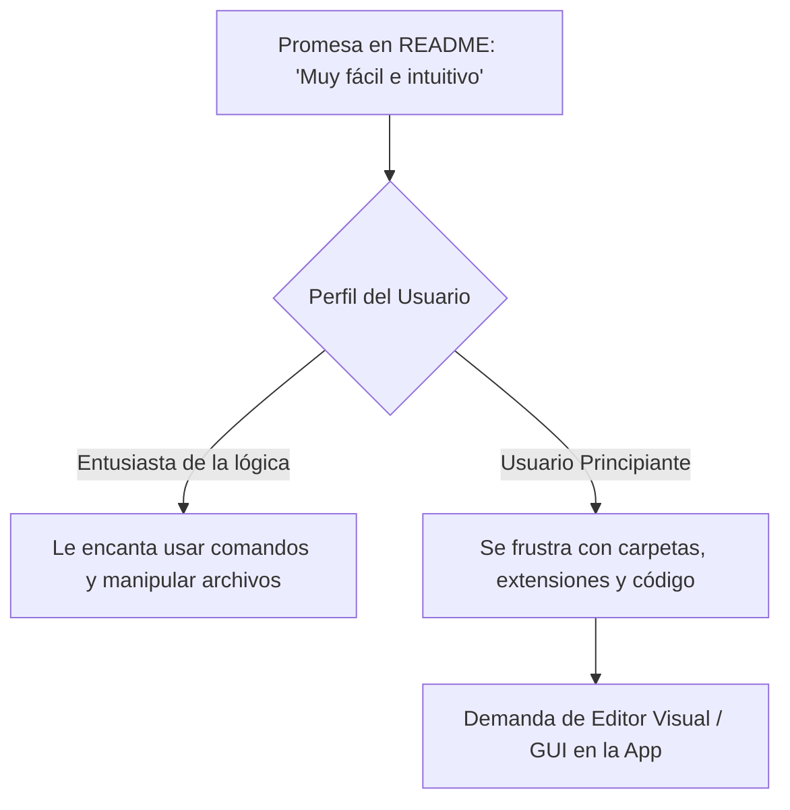

# Análisis Estratégico: Retroalimentación de Usuarios vs. README y Código Fuente

## 1. Resumen Ejecutivo

Este documento presenta un estudio comparativo y cruzado entre la experiencia de los usuarios expresada en las **66 reseñas de Google Play Console (2014-2024)** y lo prometido/documentado en el **`README.md`** y el código fuente en Java del motor **AlexiaVN Player**.

El objetivo es identificar las **brechas de usabilidad (usability gaps)**, evaluar el impacto de las características ya implementadas y proponer una hoja de ruta técnica (roadmap) fundamentada en datos reales de uso.

---

## 2. Análisis Cruzado: README vs. Experiencia Real del Usuario



### 2.1. Curva de Aprendizaje y Usabilidad

| Aspecto | Promesa del README / Documentación | Realidad según Comentarios de Usuarios | Brecha (Gap) Identificada |
| :--- | :--- | :--- | :--- |
| **Facilidad de uso** | *"Es muy fácil de usar con instrucciones intuitivas y no es necesario saber programar."* | Opiniones polarizadas: Para creadores avanzados es *"fácil y hace pensar lógicamente"*, pero para principiantes es *"complicada y enreversada"*. | **Media**: La manipulación manual de carpetas en la SD y la sintaxis por comandos `+` asusta al usuario casual de móvil. |
| **Creación de Recursos** | Las imágenes y audios se colocan manualmente en subcarpetas (`Scenes/`, `Chars/`, `BGM/`). | Usuarios preguntan constantemente: *"¿Cómo agrego imágenes? ¿Necesito un gestor externo?"* | **Alta**: Dependencia de exploradores de archivos de terceros (ASTRO, ZArchiver) que rompen la experiencia nativa de la app. |
| **Instrucciones y Tutoriales** | Redirección a enlaces de YouTube y documentación web externa. | Usuarios critican salir de la app: *"¿Por qué ir a YouTube a ver el tutorial? ¿Tan difícil era ponerlo dentro de la app?"* | **Alta**: Falta de un módulo de Onboarding/Tutorial interactivo integrado en el reproductor. |

---

### 2.2. La Petición Estrella: Exportación a APK Independiente

- **Promesa del README**: AlexiaVN se presenta como un reproductor (`Player`) para leer novelas locales o compartidas en archivos `.zip`.
- **Reclamo Frecuente de la Comunidad**: Múltiples reseñas (desde 2019 a 2022) solicitan la capacidad de **compilar o exportar las historias creadas a un APK independiente**.
- **Análisis del Desarrollador vs. Usuario**:
  - *Visión del Usuario*: Quiere publicar sus propios juegos en Play Store o enviarlos a sus amigos como apps independientes sin obligarlos a instalar AlexiaVN Player.
  - *Visión Técnica Actual*: La app funciona leyendo scripts dinámicos en tiempo de ejecución.
- **Oportunidad de Innovación**: Implementar una herramienta CLI, script o plantilla ("Standalone Wrapper") que empaque los archivos del proyecto y el motor en un APK ejecutable.

---

### 2.3. Internacionalización (i18n) y Barrera Idiomática

- **Estado Documentado**: El `README.md` principal está en español y existe un `README.en.md` básico. La interfaz de la app carece de archivo `strings.xml` multilingüe completo.
- **Impacto en Reseñas**: Decenas de usuarios internacionales de EE.UU., Rusia, Alemania, Francia, Indonesia y Brasil han calificado la app con 1 estrella expresando: *"No entiendo nada"*, *"Please add English"*, *"Le cubo de basura no entiende ni una palabra"*.
- **Impacto Estratégico**: La falta de internacionalización es la **principal causa de pérdida de usuarios globales** y calificaciones negativas injustificadas de usuarios que no hablan español.

---

### 2.4. Evolución de Funcionalidades: Promesas Cumplidas

El análisis histórico demuestra que la evolución del proyecto respondió efectivamente a las peticiones del público:

```
Petición de Usuarios (2017-2019)  ───>  Solución Implementada en Código (2021)
----------------------------------     ---------------------------------------
• "Falta opción de guardado/reanudar"  ───>  Sistema de Slots + SQLite ('recents')
• "Agregar videos cinemáticos"         ───>  Comando [VIDEO] y VideoView nativo
• "Personalizar nombre de personaje"   ───>  Comando [NPLAYER] y SharedPreferences
• "Error de permisos en Android 11"    ───>  MANAGE_APP_ALL_FILES_ACCESS_PERMISSION
```

---

## 3. Matriz FODA (SWOT Analysis)

### Fortalezas (Strengths)
- **Motor Ligero y Eficiente**: Corre fluido en dispositivos de gama baja y versiones antiguas de Android (desde Android 4.0/5.0).
- **Sin Publicidad ni Anuncios**: Muy valorado por los usuarios (#32).
- **Sintaxis de Script Flexible**: Gran capacidad de personalización mediante comandos (`CHOICES`, `CHARBIG`, `FADEIN`, `VIBRATE`, `TEXTBOXTRANS`).
- **Código Abierto (GPL v2+)**: Permite la colaboración de la comunidad.

### Oportunidades (Opportunities)
- **Internacionalización (Inglés / Portugués)**: Captar miles de creadores de novelas visuales en los mercados angloparlante y latinoamericano.
- **Compilador/Exportador a APK o Web**: Convertir a AlexiaVN en la alternativa móvil líder a Ren'Py o Visual Novel Maker.
- **Onboarding Interactivo**: Reemplazar la necesidad de videos en YouTube con una novela visual interactiva de demostración/tutorial integrada.

### Debilidades (Weaknesses)
- **Dependencia de Gestor de Archivos Externo**: Los usuarios deben manipular carpetas manualmente con apps de terceros.
- **Falta de Botones Estándar de VN**: Carece de botones de **Backlog (Historial de Diálogo)** y **Skip (Avanzar Rápido)**.
- **Interrupción en Android 11 por Permisos**: Confusión generada en usuarios por las solicitudes de permisos de almacenamiento.

### Amenazas (Threats)
- **Políticas Restrictivas de Permisos de Google Play**: Incremento en las restricciones de acceso a archivos completos (`All Files Access`).
- **Abandono por Frustración Inicial**: Usuarios novatos que desinstalan la app en menos de 5 minutos al no entender la estructura de carpetas.

---

## 4. Hoja de Ruta Sugerida (Actionable Roadmap)

### Fase 1: Optimización de UX e Internacionalización (Corto Plazo)
1. **Soporte Multilingüe (i18n)**:
   - Crear `values-en/strings.xml` y `values-pt/strings.xml`.
   - Traducir los comandos básicos del reproductor e interfaz.
2. **Tutorial Interactivo Integrado**:
   - Reemplazar la necesidad de YouTube con un proyecto demo interactivo que enseñe a jugar y crear dentro de la propia app.

### Fase 2: Mejoras de Reproducción y Navegación (Mediano Plazo)
1. **Botones de Backlog & Skip**:
   - Implementar en [`alexavn.java`](file:///Users/fernandomaceda/Documents/GitHub/AlexiaVN/AlexiaVNPlayer/app/src/main/java/maceda/alejandro/alexiavnplayer/alexavn.java) un historial para revisar diálogos anteriores y un botón de avance rápido para saltar texto.
2. **Selector Visual de Recursos**:
   - Integrar un picker gráfico interno para añadir imágenes y audios a las carpetas del proyecto sin salir de la app.

### Fase 3: Exportador y Ecosistema (Largo Plazo)
1. **Investigación de Exportador Standalone / APK**:
   - Diseñar un módulo o herramienta independiente para compilar un proyecto AlexiaVN dentro de un APK firmado listo para distribución.
